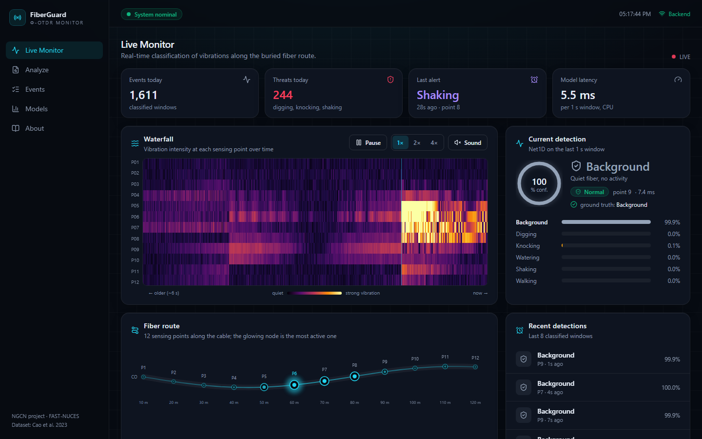
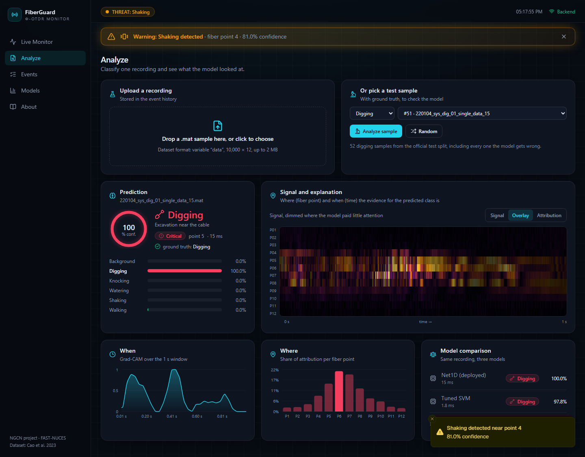
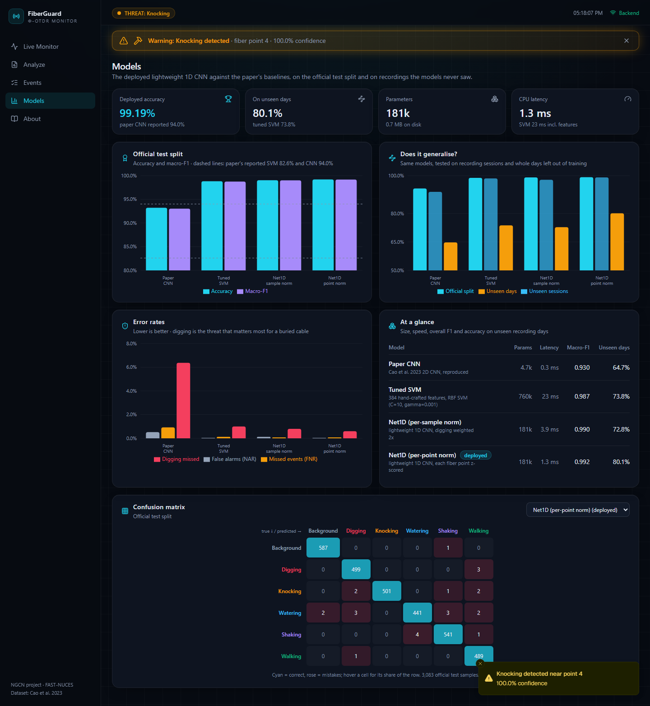
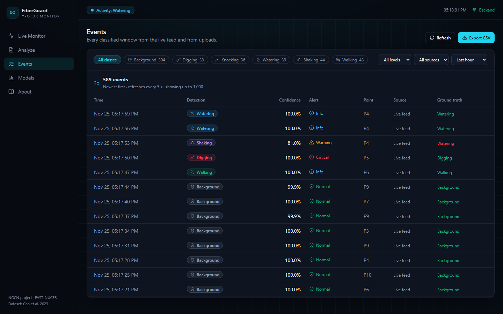
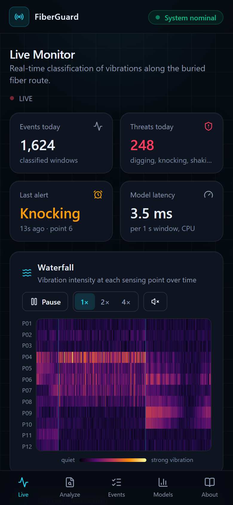

# FiberGuard: Φ-OTDR intrusion detection for buried fiber cables

AI-based intrusion and threat detection for underground optical fiber cables using Φ-OTDR (NGCN course project,
FAST-NUCES Faisalabad). A lightweight 1D CNN classifies one-second vibration windows from 12 sensing points
into **background, digging, knocking, watering, shaking, walking** and raises alerts in a live dashboard.
Base paper and dataset: Cao et al., *Results in Optics*, 2023 (BJTUSensor Φ-OTDR dataset, 15,419 samples).

No Docker: everything runs natively on Windows, CPU only.



## Results

| Model | Params | Official test split | Unseen recording sessions | Unseen recording days | Digging missed (official) | CPU latency |
|---|---|---|---|---|---|---|
| Paper SVM (Cao et al., reported) | — | 82.6% | — | — | — | — |
| Paper CNN (Cao et al., reported) | — | 94.0% | — | — | — | — |
| Paper CNN, our reproduction | 4.7 k | 93.2% | 91.4% | 64.7% | 6.4% | 0.3 ms |
| Tuned SVM (paper's features, C/gamma tuned) | 760 k* | 98.8% | 98.5% | 73.8% | 1.0% | 23 ms |
| **Net1D, deployed** (1D CNN, per-point normalisation, digging weighted 2×) | **181 k** | **99.2%** | **99.1%** | **80.1%** | **0.6%** | **~1–3 ms** |

\* support-vector coefficients. "Unseen" columns: cross-validation with whole recording sessions (5 folds) or whole
recording days (3 folds) held out. The official split shares sessions between train and test, so it overstates how
well any model handles a new site. Details: [baselines](results/baselines.md),
[improved model](results/improved_model.md), [generalisation and explainability](results/cross_session.md),
notebooks [01_explore](ml/notebooks/01_explore.ipynb) and [02_results](ml/notebooks/02_results.ipynb).

Findings in one line each:
- The paper's SVM is far stronger than reported (98.8% once C/gamma are tuned); its code also has a uint16 wrap-around
  bug and refits the scaler on the test set.
- Net1D beats both baselines, is ~8× smaller on disk than the SVM and runs in a few milliseconds per window.
- Z-scoring each fiber point separately is what makes the model hold up on unseen recording days (+7 points).
- Grad-CAM and Integrated Gradients point at fiber points 5–8, where the vibration is; a deletion test confirms the
  highlighted time windows matter more than random ones.

## Quick start (demo)

After the one-time [setup](#setup) below:

```powershell
.
un.ps1 -Prod
```

It checks the environment, starts the backend (port 8000) and the frontend (port 3000) in two windows and opens the
browser. `.
un.ps1` alone uses the development server. The 2 GB dataset is **not** needed for the demo: the app ships
the trained model and 324 official-test samples. Optional hosting on Render + Vercel: [DEPLOY.md](DEPLOY.md).

| Analyze | Models |
|---|---|
|  |  |
| **Events** | **Phone (375 px)** |
|  |  |

## Setup

Requires [uv](https://docs.astral.sh/uv/) (provides Python 3.12) and Node.js 18+.

```powershell
uv venv .venv --python 3.12
.\.venv\Scripts\Activate.ps1
uv pip install torch --index-url https://download.pytorch.org/whl/cpu
uv pip install -r requirements.txt
uv pip install -e ml
```

## Dataset

1. Open the Google Drive folder linked from
   [BJTUSensor/Phi-OTDR_dataset_and_codes](https://github.com/BJTUSensor/Phi-OTDR_dataset_and_codes)
   (Baidu mirror code `morv`).
2. Put the two folders so the layout is:

```
ml/data/raw/train/label.txt   ml/data/raw/train/01_background/*.mat ... 06_walk/
ml/data/raw/test/label.txt    ml/data/raw/test/01_background/*.mat  ...
```

3. Verify and cache:

```powershell
python ml/scripts/verify_dataset.py
python ml/scripts/build_cache.py
```

`verify_dataset.py` writes per-class and per-recorder counts and a list of bad files to `results/`.
`build_cache.py` writes `ml/data/processed/{train,test}_X.npy` (N × 12 × 1000) plus labels and metadata
(`--norm channel` writes the per-point-normalised copy used by the deployed model).

## Reproducing the models

```powershell
python ml/scripts/extract_features.py                    # 384 SVM features per sample
python ml/scripts/train_svm.py                           # svm_paper + svm_tuned
cd ml
python -m phiotdr.train --model paper_cnn --run-name paper_cnn_long --epochs 200 --lr 1e-3 --scheduler plateau --patience 25
python -m phiotdr.train --model net1d --run-name net1d_dig2_chnorm --norm channel --augment --dig-weight 2 `
    --epochs 40 --lr 1e-3 --weight-decay 1e-4 --batch-size 64 --scheduler cosine --patience 12
cd ..
python ml/scripts/cross_session.py --protocol session    # unseen sessions (5-fold)
python ml/scripts/cross_session.py --protocol date       # unseen days (3-fold)
python ml/scripts/explain_report.py --run net1d_dig2_chnorm --shap
python ml/scripts/summarize_results.py
```

Each run writes `ml/models/<run>.pt|json` and `results/metrics_<run>.json`, `confusion_<run>.png`, `history_<run>.csv`.
Training Net1D takes ~15–30 min on a 4-core laptop CPU.

## Backend (FastAPI)

The API runs without the dataset: it ships the trained model (`ml/models/`) and a 7.6 MB pack of 324 official-test
samples (`backend/app/data/`, rebuilt with `python backend/scripts/build_demo_pack.py`).

```powershell
cd backend
uvicorn app.main:app --reload --port 8000
```

Swagger UI: <http://localhost:8000/docs>. Endpoints (all under `/api`):

| Endpoint | What it does |
|---|---|
| `GET /health` | model loaded, sample count, events stored |
| `POST /predict` | upload a dataset `.mat` (variable `data`, 10000 x 12, max 2 MB) -> class, confidences, alert level, signal, comparison with the SVM and paper CNN, optional explanation; stored as an event |
| `GET /samples?cls=&limit=&offset=` | demo samples (official test split) |
| `GET /samples/{id}` | 12 x 500 signal for plotting |
| `GET /samples/{id}/prediction` | classify a demo sample (deployed Net1D, compared with the tuned SVM and the paper CNN) |
| `GET /explain/{id}` | Grad-CAM over time + Integrated-Gradients 12 x 100 map |
| `GET /metrics` | model comparison: official split, unseen sessions, unseen days |
| `GET /events`, `GET /events/stats` | event history (SQLite) |
| `WS /stream` | simulated live fiber feed: frames every 150 ms, a prediction every ~3 s |

Alert levels: `critical` = dig; `warning` = knock, shake; `info` = walk, water; `normal` = background;
`uncertain` when confidence < 0.6. Settings are environment variables or `backend/.env` (copy `backend/.env.example`; see `backend/app/settings.py`), e.g.
`FIBER_CORS_ORIGINS`, `FIBER_DB_PATH`, `FIBER_CONFIDENCE`.

## Frontend (Next.js)

Dark "control room" dashboard: live waterfall of the fiber, alerts with sound, upload/analysis with explanations,
event history with CSV export, and the model comparison. Start the backend first, then:

```powershell
cd frontend
npm install
copy .env.example .env.local    # NEXT_PUBLIC_API_URL=http://localhost:8000
npm run dev                     # http://localhost:3000
```

| Page | What it shows |
|---|---|
| `/` Live Monitor | scrolling waterfall (12 points x time), current prediction with confidence ring, fiber route with the most active point glowing, recent detections, pause / speed / sound controls; threat banner + toast + beep on every page |
| `/analyze` | drop a `.mat` file or pick a test sample: prediction, signal with Integrated-Gradients overlay, Grad-CAM over time, importance per point, Net1D vs SVM vs paper CNN |
| `/events` | event history with class / level / source / time filters, auto-refresh, CSV export |
| `/models` | accuracy and macro-F1, generalisation to unseen sessions and days, error rates, size and speed, confusion matrices |
| `/about` | how Phi-OTDR sensing works, the six classes, key findings, citation |

## Tests

```powershell
pytest ml/tests                      # data pipeline, metrics, models, explanations (17 tests)
cd backend; pytest                   # API, uploads, stream, alerts (23 tests)
cd ../frontend; npm run lint; npm run build
python backend/scripts/e2e_check.py  # against running servers: uploads per class, live alert, pages (28 checks)
```

## Repository layout

```
ml/phiotdr/      shared package: config, data loading, preprocessing, features, models, training, metrics, explanations
ml/scripts/      dataset checks, caching, SVM, cross-validation, figures
ml/notebooks/    01_explore, 02_results
ml/models/       trained weights (*.pt + *.json), svm.joblib
results/         metrics, figures and the write-ups
backend/         FastAPI app (app/), demo sample pack (app/data/), tests, scripts
frontend/        Next.js app (app/ pages, components/, lib/)
run.ps1          one-click demo; render.yaml + DEPLOY.md for optional hosting
```
